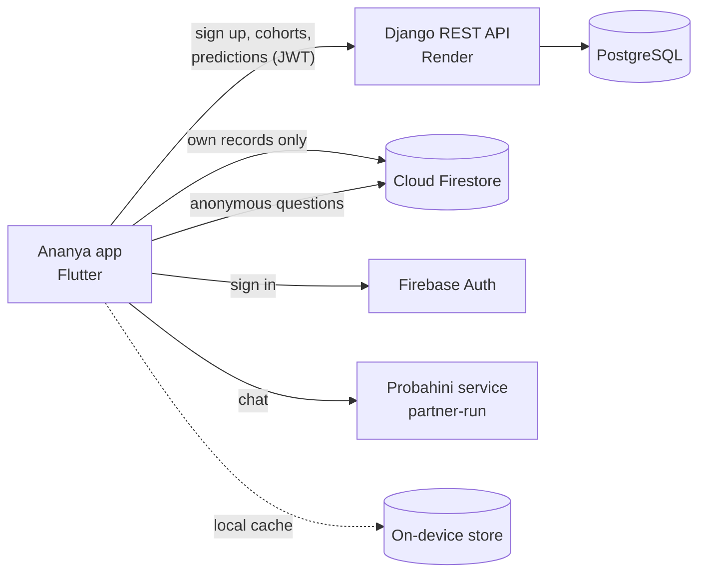

# Ananya: Menstrual Health and Period Tracking App

**Ananya** is a free, bilingual (Bangla and English) menstrual health app from **WaterAid Bangladesh**, built mainly for adolescent girls and young women. It helps users understand and track their cycle, learn the facts behind common myths, and reach trusted helplines. Its chat assistant, **Probahini**, answers everyday questions about periods.

[Get it on Google Play](https://play.google.com/store/apps/details?id=com.mhmapp.ananyaproject)

> **Note:** Shared publicly with WaterAid Bangladesh's permission for portfolio and review purposes. Firebase configuration, signing keys, API keys and all user data are excluded. See [What is not in this repository](#what-is-not-in-this-repository).

---

## At a glance

| | |
|---|---|
| **Users** | 45,000+ accounts and 2,300+ monthly active users (February 2026) |
| **Organisation** | WaterAid Bangladesh |
| **Mobile app** | Flutter (Android, published on Google Play) |
| **Back end** | Django 5 and Django REST Framework, JWT authentication, PostgreSQL, hosted on Render |
| **Cloud sync** | Firebase Authentication and Cloud Firestore, with per-user security rules |
| **Chat assistant** | Probahini, a separate service run by a partner (not part of this repository) |
| **Languages** | Bangla (default) and English |
| **Tests** | 42 Flutter test files with about 530 test cases |

---

## Credits

Designed and built by **Ponuel Mollah Swadesh**, ICT and Digital Development Officer, WaterAid Bangladesh, who also manages the product and its releases.

Later updates were contributed by **Moumita Khandaker** and **Md Rofi Uddin Rafi**, working under his supervision.

The **Probahini** chatbot service was developed by a partner and is not included here.

---

## Features

**Period tracking**
- Guided set-up that learns the user's usual cycle and period length
- Prediction of the next period, with a countdown and cycle phase
- Calendar view, period history, and correction of past entries (including adding an earlier period)
- Honest prediction windows: a wider range instead of a single date for irregular cycles or a reported condition such as PCOS
- Period reminders through local notifications
- Works offline, then syncs to the cloud when the user is back online

**Learning and support**
- **Knowledge Hub:** short articles and videos on menstrual health and hygiene
- **Myth Buster:** common myths, with the facts behind them
- **Help numbers:** national helplines for health, mental health and violence against women, with one tap to call
- **Probahini chat:** ask a question in Bangla or English. Questions are logged anonymously (age, district and the question only, no user ID) so the programme can see what girls actually ask

**Superuser (cohort) mode**
- A superuser account can add and track the cycles of a group of users (a cohort) and view the cohort's period history

**Privacy and control**
- Users can delete their account and ask for all their data to be removed
- Firestore rules let each user read and write only their own records

---

## How it works



The on-device store keeps the app usable on a weak or missing connection. When the app is back online, the server copy is treated as the authority and replaces the local cache, so two devices can't silently disagree about a user's history.

---

## Project structure

```
Ananya-App-MHM/
├── ananya/                 Flutter app
│   ├── lib/
│   │   ├── screens/        sign-up, set-up steps, home, history, cohort, help, myth buster
│   │   ├── services/       period history, local store, Firebase sync, account deletion
│   │   ├── chat/           Probahini chat screen and client
│   │   ├── l10n/           Bangla and English strings
│   │   └── widgets/, utils/, models/
│   ├── assets/             images, animations, guides
│   └── test/               widget and logic tests
├── backend/                Django REST API
│   ├── backend/            settings (all secrets from environment variables)
│   └── user/               users, cohorts, period history, predictions
├── tools/                  script to export the anonymous Probahini question log
├── firestore.rules         Firestore security rules
└── firebase.json
```

---

## Running it

### Back end (Django)

You need Python 3.10 or later and PostgreSQL.

```bash
cd backend
python -m venv venv && source venv/bin/activate    # Windows: venv\Scripts\activate
pip install -r requirements.txt
```

Create a `.env` file with your own values:

```
DJANGO_SECRET_KEY=change-me
DJANGO_DEBUG=True
DJANGO_ALLOWED_HOSTS=localhost,127.0.0.1
DATABASE_NAME=ananya
DATABASE_USER=postgres
DATABASE_PASSWORD=
DATABASE_HOST=localhost
DATABASE_PORT=5432
```

Then:

```bash
python manage.py migrate
python manage.py createsuperuser
python manage.py runserver
```

### Flutter app

You need Flutter 3.22 or later and your own Firebase project.

```bash
cd ananya
flutterfire configure        # replaces the placeholder lib/firebase_options.dart
flutter pub get
flutter test
flutter run
```

To point the app at your local back end, change `baseUri` in `lib/utils/constants.dart`, for example to `http://10.0.2.2:8000/` for the Android emulator.

Deploy the Firestore rules with `firebase deploy --only firestore:rules`.

---

## What is not in this repository

- `google-services.json`, real Firebase options, signing keys and the Play upload certificate
- Any password, Django secret key or API key. All of them come from environment variables
- The Probahini chatbot code, which belongs to a partner
- User accounts, period data, or the anonymous question log

---

## What I learned

- **Health data needs rules, not just paths.** Storing records under `users/{uid}` scopes nothing by itself. Only the Firestore rules stop one user from reading another's history.
- **"Anonymous" has to survive a small community.** A period question from a 13-year-old in a named district is easy to place, so the question log is write-only from the app and read only by analysts with a service account.
- **Offline first matters.** Many users share a phone or have patchy data, so the app keeps working locally and resolves conflicts in one clear direction.
- **Tests protect the maths.** Cycle predictions, countdowns and history corrections are easy to break quietly, so they are covered by unit and widget tests.

---

## Licence

Copyright © 2024 to 2026 WaterAid Bangladesh. Shared publicly with permission for portfolio and review purposes only. See [LICENSE.md](LICENSE.md).

## Maintainer

**Ponuel Mollah Swadesh**, ICT and Digital Development Officer, WaterAid Bangladesh
[swadeshmollah@gmail.com](mailto:swadeshmollah@gmail.com) · [GitHub](https://github.com/Swadesh1997)
